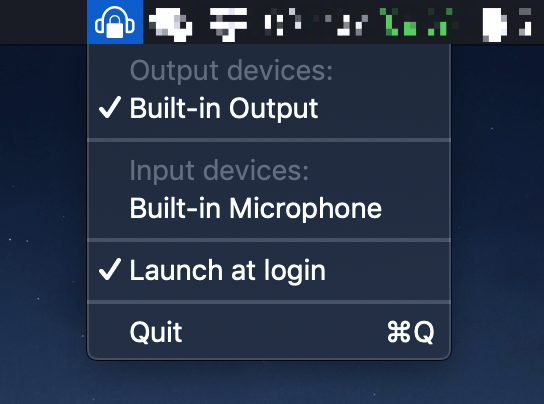

# Suohai

[](https://github.com/lbenicio/suohai/actions/workflows/unit-tests.yml)
[](https://github.com/lbenicio/suohai/releases)
[](LICENSE.txt)

Suohai is a macOS menu bar utility for keeping your chosen system audio input and output devices selected. Choose a microphone and speaker or headset from the menu bar; Suohai reapplies those choices when macOS changes the default device and restores them when the app starts.



## Features

- Choose input and output devices independently from the menu bar.
- Keep selected devices as the system-wide defaults.
- Restore saved selections when Suohai launches.
- Automatically clear a selection if its device is no longer available.
- Store selected device IDs locally using `UserDefaults`.

Suohai does not capture or transmit audio. It changes macOS audio-device defaults; it does not route audio for individual apps.

## Requirements

- macOS 27 or later
- Swift 6.4 or later to build from source

## Installation

Download the latest `Suohai.dmg` from [GitHub Releases](https://github.com/lbenicio/suohai/releases). Open the disk image and move `Suohai.app` to your Applications folder.

Release builds are currently not Developer ID-signed or notarized, so macOS may show a security warning when you open the app.

### Build from source

Install the required Swift toolchain, then clone the repository and build a disk image:

```sh
git clone https://github.com/lbenicio/suohai.git
cd suohai
make dmg
```

The disk image is created at `.build/Suohai.dmg`. To build only the app bundle, run `make pkg`; it creates `.build/Suohai.app`.

## Usage

1. Launch Suohai. Its status item appears in the menu bar.
2. Open the menu and select an available input device, output device, or both.
3. Select an active device again to clear that selection and release its default-device lock.

Selections are independent and persist locally. Suohai does not choose a device for you when no selection is saved. If a selected device is disconnected or unavailable, Suohai clears that selection.

## Development

The project uses Swift Package Manager and a layered architecture: platform-independent device and selection types live in `src/domain/`, application behavior in `src/application/`, macOS and menu bar adapters in `src/adapters/`, and startup composition in `src/app/`. Tests are organized under `tests/` by layer.

Useful Make targets:

| Command | Description |
| --- | --- |
| `make test` | Run the Swift package test suite. |
| `make build` | Build the `Suohai` executable. |
| `make lint` | Run SwiftLint with `--fix`; this may modify Swift files. |
| `make format` | Format Swift files in place with SwiftFormat. |
| `make run` | Build and launch the menu bar app. |
| `make pkg` | Create `.build/Suohai.app`. |
| `make dmg` | Create `.build/Suohai.dmg`. |
| `make clean` | Remove SwiftPM output and generated app/disk-image artifacts. |
| `make help` | List available targets. |

The unit-test and **Build DMG and release** GitHub Actions workflows are manually triggered from the repository’s **Actions** tab. The release workflow uses the first versioned section in `CHANGELOG.md` (excluding `[Unreleased]`) for the release version and notes, and aborts if that version has already been released.

For contribution guidance, see [CONTRIBUTING.md](CONTRIBUTING.md). Please follow the [Code of Conduct](CODE_OF_CONDUCT.md).

## Privacy

Suohai reads the available audio-device list and updates the system default input or output device when you make a selection. It stores selected device IDs locally in `UserDefaults`. The app does not record audio or send audio or selection data over the network.

## Security

Report suspected vulnerabilities privately by following the instructions in [SECURITY.md](SECURITY.md). Please do not file public issues containing vulnerability details.

## License

Suohai is licensed under the [GNU General Public License v3.0 only](LICENSE.txt).

## Maintainer

Maintained by [Leonardo Benicio](https://github.com/lbenicio). Questions and general inquiries: [hi@lbenicio.dev](mailto:hi@lbenicio.dev).
